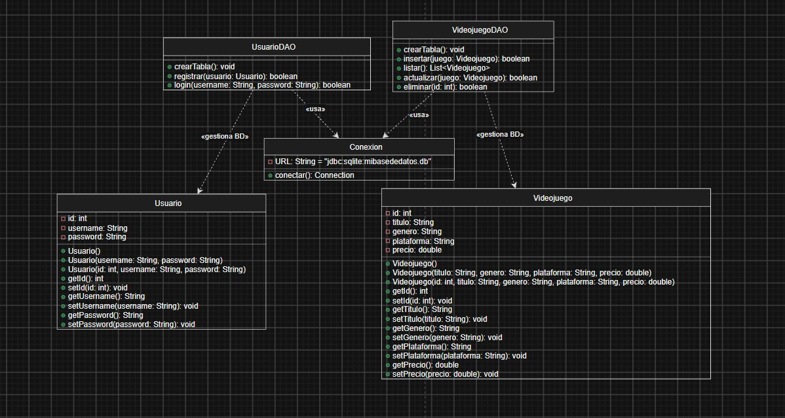
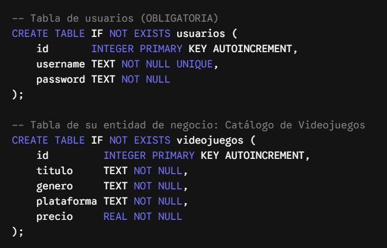

### Fases implementadas
Fase 1, diseño de la arquitectura del sistema, diagrama de clases (modelos `Usuario`, `Videojuego`) y definición del esquema relacional en SQLite. Además, creación del Módulo A, de la fase 2.

* **Diagrama de Clases UML:**
  

* **Diseño de Tablas SQL:**

  

